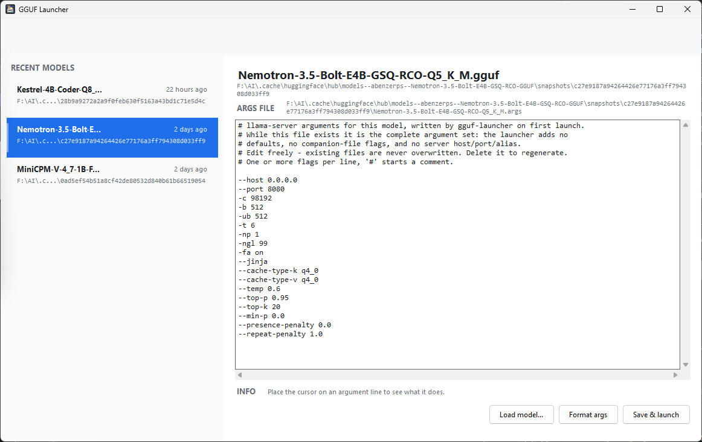

# GGUF Launcher

Double-click a `.gguf` file in Windows Explorer and a llama.cpp server starts for it,
with sensible defaults already set, and llama.cpp's web UI opens in your browser.

## What it does

- Run it with no arguments to open the native quick-pick window: the last 10 models the
  launcher opened, with their `.args` editable and one click to launch.
- Finds `llama-server.exe` (next to this exe, on `PATH`, via `LLAMA_SERVER`, or in
  WinGet packages).
- Detects companion files next to the model: `mmproj-*.gguf` for vision models and
  `dspark-*` / `*draft*` / `*-mtp*` files for speculative decoding, and wires them up.
- Starts `llama-server.exe` with the derived flags, streams its logs to the console,
  waits for `/health` to answer, then opens the browser.
- On the first launch the effective arguments are written to `<model-name>.args` next to
  the model. That file is never overwritten; while it exists it is the complete argument
  set, so the launcher adds no defaults and re-detects no companion files.
- Registers itself as the handler for `.gguf` files (per user, no administrator needed).



## Build

```powershell
dotnet publish -c Release -r win-x64 -o publish
```

The output is a single self-contained, trimmed `GgufLauncher.exe`. Trimming (partial mode)
removes unused framework code, cutting the exe to roughly 44 MB (down from ~66 MB untrimmed).

## Use

Start the native quick-pick window (no arguments):

```powershell
GgufLauncher.exe
```

The window lists the last 10 models the launcher opened, most recent first. Use `Load model...`
to pick a `.gguf` that is not in the list yet; it joins the recent list and opens with the
generated default arguments. Selecting a model shows its `<model-name>.args` (or a generated
preview when the file does not exist yet), lets you edit and save it, and launches the model
with the normal headless flow in a new console window. An INFO row under the editor explains
the argument on the line under the cursor or mouse; flags it does not know are passed through
to llama-server unchanged. Use `Save & launch` to launch exactly what is in the editor, and `Ctrl+S` to save.
The list is stored in `%LOCALAPPDATA%\GgufLauncher\recent-models.json`.

Opening a `.gguf` file (or passing a model path) never shows this window; it keeps the
headless console behavior below. The only side effect is that the model is recorded in the
recent list.

Launch a model directly:

```powershell
GgufLauncher.exe model.gguf
# or, llama-server style:
GgufLauncher.exe -m model.gguf
```

Register the file association (per user):

```powershell
GgufLauncher.exe --register
```

Remove it again:

```powershell
GgufLauncher.exe --unregister
```

Skip opening the browser:

```powershell
GgufLauncher.exe model.gguf --no-browser
```

Any extra arguments are passed straight through to `llama-server`.

## Configuration

There is no JSON configuration. Defaults are baked into the launcher (context 98192,
batch 512, 6 threads, 99 GPU layers, flash attention, jinja, q4_0 KV cache, ...).

Override them with plain `.args` files (one or more flags per line, `#` starts a
comment):

1. Global: `gguf-launcher.args` next to `GgufLauncher.exe`
2. Per model: `<model-name>.args` next to the `.gguf`

Command-line arguments win over both. Later flags win within a file.

On the first launch the launcher creates `<model-name>.args` next to the model, with the
full effective argument list passed to `llama-server` (everything except the model
path), including the built-in defaults and the flags derived from companion files.

That file is never overwritten. While it exists it is the complete argument set for the
model: the launcher adds neither the built-in defaults nor companion-file flags, so
deleting a line actually removes that flag from the launch. It only adds `-m`. Delete the
file to have it regenerated with fresh defaults and detection. The global
`gguf-launcher.args` next to the exe is never written by the launcher and still applies
before the per-model file.

The launcher adds `--host 0.0.0.0 --port 8080` only on that first launch, when there is no
per-model `.args` file yet; the generated file records them. After that it adds nothing: if
the file has no `--host`/`--port`, llama-server's own defaults apply (`127.0.0.1:8080`).
`--alias` is never added. The browser URL and health check follow whichever host/port is
effective, mapping wildcard binds to loopback.

Example `gguf-launcher.args`:

```
# keep it private
--host 127.0.0.1
# smaller context for a small GPU
-c 32768
```

## Notes

- Without a per-model `.args` file the launcher binds `0.0.0.0:8080`, so the model is
  reachable from other machines on the network. Once the file exists it decides: with no
  `--host` / `--port` there, llama-server's default `127.0.0.1:8080` applies. Add
  `--host 127.0.0.1` to an args file to keep it private.
- Windows 11 does not let applications set the "default app" hash, so the launcher
  registers the association but you may still need to pick it once in *Open with* /
  *Default apps*.
- Press `Ctrl+C` in the launcher console to stop the server.
- If `llama-server` crashes on its own (non-zero exit code), the launcher prints the
  exit code and waits for a keypress before closing, so the error stays visible.
  Pressing `Ctrl+C` to stop the server yourself does not trigger the pause.